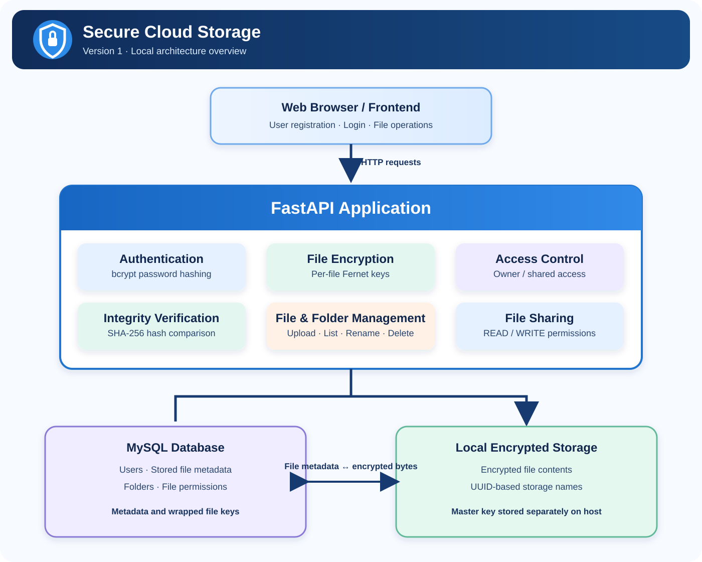

# Secure Cloud Storage

**Version 1 — Local implementation** · **Version 2 — Cloud deployment planned**

A FastAPI-based file storage application using MySQL, bcrypt password hashing, per-file encryption, and SHA-256 integrity verification. Version 1 is focused on the local implementation and security review. Cloud deployment is planned for Version 2.

---

## 1. Project Overview

Secure Cloud Storage provides account registration, file upload and download, encrypted-at-rest storage, file organization, and sharing between registered users.

### Architecture



*Version 1 architecture: the FastAPI application connects to MySQL for metadata and the local filesystem for encrypted file contents. This is not the planned Version 2 cloud architecture.*

### Main components

- **Frontend:** Browser-based interface.
- **API:** FastAPI application for authentication and file operations.
- **Database:** MySQL stores users, file metadata, folders, and sharing permissions.
- **File storage:** Local filesystem stores encrypted file contents.
- **Cryptography:** Independent Fernet key per file, protected by a local master key.

---

## 2. Implemented Functionality

- User registration with bcrypt password hashing.
- Login credential verification.
- File upload, listing, download, rename, and deletion.
- Per-file encryption using Fernet.
- Per-file encryption keys wrapped using a local master key.
- SHA-256 integrity hash stored with file metadata and checked during download.
- Folder creation and folder listing.
- File sharing with READ and WRITE permission values.
- Permission revocation.

> **Authentication status:** Login verifies credentials, but the current implementation's protected-route identity handling is not yet production-grade. Do not treat the current authentication flow as secure session-based authentication until the audit findings below are fixed and retested.

---

## 3. Technology Stack

| Area | Technology |
|---|---|
| Language | Python |
| API framework | FastAPI |
| Database | MySQL |
| ORM / database access | SQLAlchemy |
| Database driver | PyMySQL |
| Password hashing | bcrypt |
| File encryption | Fernet via `cryptography` |
| Integrity verification | SHA-256 |
| ASGI server | Uvicorn |
| Frontend | HTML, CSS, JavaScript |

---

## 4. Encryption Design

The application uses an envelope-encryption approach:

1. A new Fernet key is generated for each uploaded file.
2. The file contents are encrypted with that per-file key.
3. The per-file key is encrypted (wrapped) using the local master key.
4. The encrypted file contents are written to local storage.
5. The wrapped key and file metadata are stored in MySQL.
6. During download, the application unwraps the file key, decrypts the file, and compares its SHA-256 hash with the stored hash.

The master key is currently managed as a local file. It must be protected separately from the encrypted file data and must not be committed to the repository.

---

## 5. Database

The current data model includes:

| Table | Purpose |
|---|---|
| `users` | Registered user accounts and password hashes |
| `stored_files` | File metadata, integrity hash, and wrapped file key |
| `folders` | Folder records and ownership |
| `file_permissions` | Sharing permissions between users and files |
| `refresh_tokens` | Model exists in the codebase; not currently used as an active authentication flow |

---

## 6. Run Locally

### Prerequisites

- Python
- MySQL Server
- Git

### Install dependencies

```bash
python -m venv .venv
```

On Windows PowerShell:

```powershell
.venv\Scripts\Activate.ps1
pip install -r requirements.txt
```

### Configure environment

Create a `.env` file in the project root and configure the MySQL connection and storage settings used by the application. Example:

```ini
DB_USER=your_mysql_user
DB_PASSWORD=your_mysql_password
DB_HOST=127.0.0.1
DB_PORT=3306
DB_NAME=secure_cloud

STORAGE_DIR=storage
ENCRYPTION_KEY_FILE=secret.key
```

Keep `.env`, database credentials, and `secret.key` out of version control.

### Start the API

```bash
uvicorn api.main:app --reload --host 127.0.0.1 --port 8000
```

- API root: http://127.0.0.1:8000/
- Swagger UI: http://127.0.0.1:8000/docs
- Health check: http://127.0.0.1:8000/health

---

## 7. Security Audit — Version 1

Version 1 includes security mechanisms such as bcrypt password hashing, per-file encryption, wrapped file keys, and SHA-256 integrity verification. A code-level review also identified issues that must be addressed before production use:

| Finding | Current observation | Required action |
|---|---|---|
| Identity trust | Protected-route identity can be derived from caller-supplied headers such as `X-Username` / `Authorization` | Replace with server-validated authentication; never trust a caller-provided username as proof of identity |
| Login and logout | Login verifies credentials but does not establish a secure server-side session; logout does not revoke one | Implement secure session creation, expiry, validation, and revocation |
| Duplicate route | The file download path has duplicate route definitions | Keep one correctly implemented and tested download handler |
| Permission enforcement | File access checks permission existence but do not consistently enforce READ versus WRITE semantics | Enforce the required permission level on each operation |
| CORS | Wildcard origins are configured alongside credential support | Restrict origins to explicit trusted frontend origins |
| Production readiness | Local master-key file and local storage are used | Introduce managed key protection, hardened configuration, and deployment controls |

This section records an initial code review; it is **not a certification or a claim that the listed issues have been fixed**. Security testing and remediation must be completed and documented before production deployment.

---

## 8. Version Roadmap

### Version 1 — Local implementation and security audit

- FastAPI backend with MySQL.
- Local encrypted file storage.
- File encryption and integrity verification.
- File and folder operations.
- Sharing and permission model.
- Security review and remediation work.

### Version 2 — Cloud deployment (planned)

**Cloud deployment has not been completed in Version 1.** The planned Version 2 work includes:

- Deploying the application to AWS.
- Moving file storage to Amazon S3.
- Using AWS KMS for managed encryption-key protection.
- Configuring a production-ready database and network architecture.
- Enforcing HTTPS and secure authentication/session handling.
- Applying OWASP-focused security testing and remediation.
- Adding centralized logging, monitoring, and audit trails.
- Automating infrastructure and deployment where appropriate.

---

## 9. Project Objective

The project is intended to demonstrate practical backend engineering and security concepts: authentication design, access control, encryption at rest, key management, data integrity, relational data modeling, and the progression from a local application to a cloud-deployed system.
